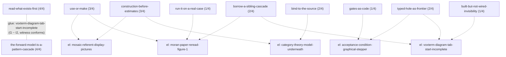

# Verdict: one operator turn read as a pattern cascade (2026-11-11)

Joe, opening the M-repl-circus push: "The first criterion ... is producing an
actual 'legal' cascade for each turn. If we can produce even one, that would
be a great start."  This is that one.  **Verdict: legal cascade** — two
complete occurrences glued on one shared situation element, one connected
component (CASCADE-SPEC-v3 §3.1: a set with no shared element is a bag; this
set has one).

## The turn

Session `ed69fb38-e76d-4009-8bc7-880ea8a99bf8` (claude-13), frame 178 of 179,
Joe at 2026-11-11T16:15:24.046120661Z (evidence `emacs-d1ceee43f003a912322bce0c0f951169`),
beginning "OK, so our aim is to work through M-repl-circus completely".  The
situation is the turn alone: **the reply had not landed** when the mapping was
made (checked at 16:26Z, 16:30Z, 16:36Z; the frame's `reply` key was still
absent), per the job's 20-minute rule.  `frame.json` is the recorded frame.

## Candidates and N/4 (26 candidates)

Seeds: the 3 prompt-header retrievals + the frame's 2 embedding retrievals;
plus 20 one-step neighbours in the giant graph
(`storage/operator-turns/mined-pattern-graph.json`, strongest edge kinds
first: 3 `why`, 7 `co-cited`(+`next-in-session`), 10 `next-in-session`).

| N/4 | count | patterns |
|---|---|---|
| 4/4 (complete) | 2 | cascade-construction/read-what-exists-first; forward-model/the-forward-model-is-a-pattern-cascade |
| 3/4 | 2 | peeragogy/use-or-make (BECAUSE missing in the pattern); math-strategy/construction-before-estimates (THEN: the turn enacts construction-first but does not state it) |
| 2/4 | 3 | proof-search/typed-hole-as-frontier (IF, THEN); translation/bind-to-the-source (IF, BECAUSE); cascade-construction/borrow-a-sibling-cascade (IF, THEN) |
| 1/4 | 7 | declare-the-universe, gates-as-code, handoff-preserves-context, built-but-not-wired-invisibility, add-a-pattern-when-an-item-fits-no-class, run-it-on-a-real-case, hedged-lift |
| 0/4 (void) | rest | incl. social/ARGUMENT (no four parts — argument document), the two `problems/` nodes, wr-18, step-machine, records-carry-warrant, verify-in-the-serving-process |

(Table counts 2+2+3+7=14 partially-or-fully occurring; 12 fully void. See
`occurrences.json` for every void part's reason.)

Mapping was done by hand (kimi-2); all 27 quotes are verbatim substrings of
the turn text, string-checked mechanically: **0 failures**.

## The two complete occurrences

**read-what-exists-first**: IF → "producing an actual 'legal' cascade for
each turn" (a cascade is to be constructed); HOWEVER → "scoped as 'multi-day'
though my guess is ... less than one day" (writing from the statement is
faster); BECAUSE → "Voxterm 'Diagram' tab ... wasn't complete yet" (the prior
attempt's state decides what the cascade needs); THEN → "reading-moran-1971.md
is worth rereading and figure-1-cascade-of-64-patterns.png ..." (read the
sources first).

**forward-model/the-forward-model-is-a-pattern-cascade**: IF → "the local
cascades would all be local regions inside the GCC" (the indexed corpus to
compose from); HOWEVER → "Voxterm 'Diagram' tab ... wasn't complete yet"
(existing forward view incomplete); BECAUSE → "each turn can be thought of as
'potentially' a cascade (a null cascade if no patterns are found)" (patterns
as the reusable shape); THEN → "some kind of wiring diagram that would run
through a session ... how the individual turn cascades hook up into a bigger
diagram" (the cascade-shaped forward model).

## Gluing

One glue: both occurrences map a part to the same situation element
**`voxterm-diagram-tab-start-incomplete`** (read-what-exists-first's G ~
forward-model's I2).  Witness hand-stated and checked with
`#'futon2.aif.wm.executable-cascade/witness-conforming?`:

```
witness: {:kind :consistency
          :digest 24bdde3275488cf7694cf8c8728b2a1443e048aa81cd03dc3b290750ca2f6d9d
          :objects [occ/read-what-exists-first@ed69fb38-turn-178
                    occ/forward-model-is-a-pattern-cascade@ed69fb38-turn-178]}
conforming: true          (control with a bad digest: nil)
```

## Validator outputs (verbatim)

`three-halves-square/validate` (futon2 classpath, `validate_cascade.clj`):

```
cascade-construction/read-what-exists-first -> :valid
forward-model/the-forward-model-is-a-pattern-cascade -> :valid
```

`build-structural` succeeds; the overlap edge classifies as a real `:gluing`
(not a `:shared-name-candidate`), census open = both occurrences:

```
{:schema :wm/structural-cascade-v1
 :digest 328d7070d782cccd0ca84288f9b3aebd8a79b9a1a219d6d125861b51d30a9cc4}
```

`validate-cascade`, after mechanical identity/census bindings are filled, stops at:

```
{:status :cascade-validation-error
 :clause :population-executable-set
 :repair {:executable []
          :occurrences ["occ/forward-model-is-a-pattern-cascade@ed69fb38-turn-178"
                        "occ/read-what-exists-first@ed69fb38-turn-178"]}}
```

That clause is the finding: the structural cascade is legal, but certification
needs the executable layer (`:executable-nodes` with clause
operation/completion-check/capability per occurrence), which this job was
forbidden to author.

## Diagram (LAB style)



Solid membership in the cascade is only the two glued 4/4 occurrences; dotted
edges show partial occurrences sharing named elements (not glue — voids are
not occurrences).
