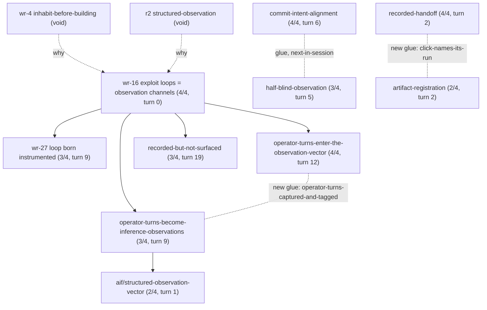

# LAB 2026-10-24 — one session read post hoc as a pattern cascade, checked against the giant graph

Joe (2026-10-24, ~22:55Z): "a post hoc theorisation of each session (say) as a
pattern cascade, which is also a sublattice of the giant connected cascade",
and "improved retrieval (猴 or 驴) needs to be a consumer of this work".
This is the first instance, run by claude-11 on its own REPL session with Joe,
and it is read-only.

## What was run

- **Session:** `8d4df137-fdc5-42c3-a5dd-ba6bb306959c`. It has 25 operator turns, from 19:44Z to 22:54Z.
- **Giant graph:** rebuilt with `scripts/mined_pattern_graph.py` into the
  experiment directory, not the shared copy. It has 1,456 patterns and 6,316
  edges; the giant component holds 822 patterns (`sha256 df8f0d9c…`).
- **Candidates (26):**
  - the 4 patterns that reached ≥2/4 mapped parts in this session's live
    `:pattern_verdicts` or in the chain experiment, excluding `iching/*`;
  - 2 partials;
  - the 20 graph neighbours of those seeds with the strongest edge kinds
    (6 by `why`, 14 by `co-cited`).
- **Mapper:** 馬-sonnet (job `invoke-1792882518431-3276-f55d6027`). It mapped each
  candidate's four parts over the whole session, with verbatim quotes of at
  least 5 words, reusing one element name for one situation element.
- **Checks (claude-11):** every quote was string-checked against the side it
  names (0 failures). `occurrence_square.py square` was run on the result.
- **Files:** `~/notes/experiments/2026-10-24-session-cascade/`. They include
  `verified.json` and `session-squares.edn`.

## Result

| status | count | patterns |
|---|---|---|
| complete occurrence (4/4) | 4 | `stack-coherence/commit-intent-alignment`, `war-room/wr-16-operationalised-exploit-loops-are-first-class-observation-channels`, `features/operator-turns-enter-the-observation-vector`, `orchestration/recorded-handoff` |
| partial (2–3/4) | 11 | e.g. `problems/operator-turns-become-inference-observations` 3/4, `process/recorded-but-not-surfaced` 3/4, `war-machine/half-blind-observation` 3/4, `war-room/wr-27-…` 3/4, `cascades/on-the-fly-cascade` 3/4 |
| void (0/4) | 11 | incl. `wr-16`'s own `@why` ancestors `war-room/wr-4-inhabit-before-building` and `problems/r2-structured-observation` |

Of the 20 graph-neighbour candidates, 9 occur at least partially. Two of the
six complete or near-complete patterns are such neighbours, and retrieval never
proposed either.

**Gluing on shared elements gives a bag, not a cascade.** No two complete
occurrences share an element. Four glue pairs exist if partial occurrences are
included:

| pair | shared element | in the giant graph? |
|---|---|---|
| commit-intent-alignment — half-blind-observation | port-table-says-fed-records-lack-it | yes (`next-in-session`) |
| recorded-but-not-surfaced — wr-16 | xiaoxiang-draft-unconsumed | yes (`why`) |
| operator-turns-enter-the-observation-vector — operator-turns-become-inference-observations | operator-turns-captured-and-tagged | **new** |
| artifact-registration — recorded-handoff | click-names-its-run | **new** |

**As a subgraph of the giant cascade, the session is mostly connected.** Five
authored `@why` edges join the session's patterns. All of them point to
`wr-16`, except one, which points to `operator-turns-become-inference-observations`:

Solid arrows run from the `@why` ancestor to the pattern that cites it. Dotted
lines are glue through a shared element.

**Order:** the first-occurrence turn order respects 4 of the 5 `why` edges.
`wr-16` occurs at turn 0, before each of its children. The exception is
`aif/structured-observation-vector`, which occurs at turn 1, while its ancestor
`operator-turns-become-inference-observations` first occurs at turn 9. It is
only a 2/4 partial.

## Reading

- **The giant graph supplies the structure that element gluing misses.** The
  `why` edges connect six of the session's patterns in one tree under `wr-16`.
  Gluing by element name joins only pairs, because the mapper gave related
  elements different names (39 names over 43 maps). Gluing by element
  name alone under-reports cascades. Either the element vocabulary needs to be
  shared across patterns, for which m40 entities are the candidate already
  named in LAB-2026-10-16-occurrence-squares, or the graph's edges should count
  as glue when both endpoints occur.
- **The roots did not occur.** `wr-16` occurred, but neither of its own `@why`
  ancestors did. The session instantiates a sub-tree of the giant cascade below
  `wr-16`. This is the concrete content of "sublattice" here, with the caveat
  that the lattice structure (meets, acyclicity of `why`) has not been checked.
- **For retrieval (猴/驴).**
  - The neighbours of patterns that occurred are a better pool of candidates
    than embedding retrieval over the operator's turn. 9 of 20 neighbours
    occurred at least partially. Of the 18 proposals that embedding retrieval
    made over six of this session's turns, 4 occurred at least partially and
    1 in full (`LAB` in `~/notes/experiments/2026-10-24-chain-occurrences`).
  - The two pools were measured differently, so this is a lead to test, not a
    comparison: the whole session versus a chain of six turns, and candidates
    proposed after the fact versus at the time.
  - The test is to propose, at turn n, the graph neighbours of patterns that
    occurred up to n−1, and to score them by the same occurrence rule on later
    turns.
- **Side of the maps.** 3 of 43 maps quote the operator (all in partials). Every
  other map quotes the reply. This repeats the 65/67 finding of the 小象-guards
  run.

## Limits

- One session. The mapper had the whole session in view, so the post hoc reading
  sees connections that no single turn could.
- The candidate pool was seeded from this session's own occurrences, so it is
  biased towards what had already been found.
- The order check uses first occurrence only. Partial occurrences are counted at
  their first mapped part.
